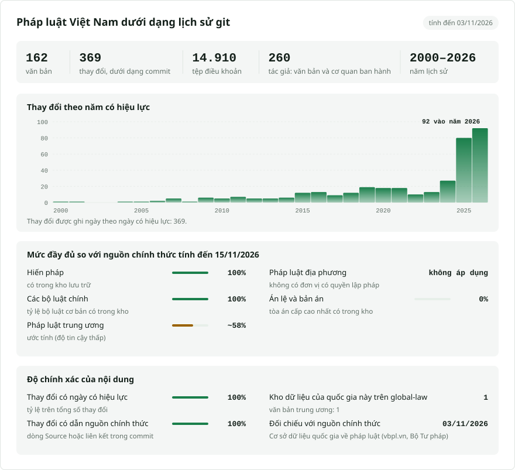

# Việt Nam: lịch sử pháp luật trong git

**Tiếng Việt** · [English](README.en.md)

<picture>
<source media="(prefers-color-scheme: dark)" srcset="data/vi/effort-dark.svg">

</picture>

Pháp luật Việt Nam dưới dạng lịch sử git: mỗi điều một tệp, mỗi luật một commit vào ngày có hiệu lực, và tác giả của commit là luật đã thực hiện thay đổi đó. `git blame` cho biết luật nào đứng sau từng dòng; `git log` liệt kê mọi thay đổi của một điều; chọn một ngày sẽ cho văn bản có hiệu lực vào ngày đó.

Là một phần của [lexifina/global-law](https://github.com/lexifina/global-law), một lịch sử git duy nhất cho pháp luật của mọi quốc gia: đây là pháp luật cấp quốc gia của Việt Nam, được global-law đọc tại `vietnam/national/acts/`.

**Nội dung hiện có:** 162 văn bản của Quốc hội, mỗi văn bản từ văn bản gốc khi được thông qua cùng các lần sửa đổi đến năm 2026: Hiến pháp năm 2013, sáu bộ luật (Bộ luật Dân sự, Hình sự, Tố tụng dân sự, Tố tụng hình sự, Lao động và Hàng hải) và 155 luật, với 513 phiên bản có hiệu lực từ ngày 1 tháng 4 năm 2000 đến ngày 1 tháng 10 năm 2026. [`REPRODUCE.md`](REPRODUCE.md) liệt kê mọi văn bản cùng các phiên bản và ngày đầu, ngày cuối của văn bản; [`data/laws.csv`](data/laws.csv) liệt kê 280 luật mà hồ sơ này nêu tên (các văn bản và các luật đã sửa đổi chúng), cùng ngày tháng và trang vbpl.vn của từng luật.

Mỗi văn bản là một thư mục đặt tên theo số hiệu, `<kind>/<year>/<number>/`, mỗi điều một tệp: `bo-luat/2019/45-2019-qh14/art-154.md` là Điều 154 của Bộ luật Lao động (Luật số 45/2019/QH14); Hiến pháp nằm trong `constitution/hien-phap/`. `loi-mo-dau.md` chứa lời nói đầu, `cau-truc.md` các tiêu đề phần, chương và mục, `ket-thuc.md` dòng kết thúc, và `README.md` của mỗi văn bản liệt kê các điều cùng số lần mỗi điều đã thay đổi. Cho đến ngày 11 tháng 11 năm 2026, mỗi thư mục được đặt tên theo mã của văn bản (`bo-luat-lao-dong/`); [`data/paths.json`](data/paths.json) ánh xạ từng mã sang thư mục của nó, và các thẻ phiên bản (`bo-luat-lao-dong/2026-07-01`) vẫn giữ các mã này.

Văn bản bằng tiếng Việt, như vbpl.vn và Công báo công bố. Bản dịch tiếng Anh không thuộc hồ sơ này.

## Các câu hỏi dưới dạng lệnh git

| Câu hỏi | Lệnh |
| --- | --- |
| Mọi thay đổi của Điều 154 (người lao động nước ngoài không cần giấy phép lao động) Bộ luật Lao động | `git log -p --follow --word-diff -- bo-luat/2019/45-2019-qh14/art-154.md` |
| Luật nào đã viết từng dòng của Điều 154? | `git blame bo-luat/2019/45-2019-qh14/art-154.md` |
| Mọi phiên bản của Bộ luật Lao động, cùng ngày có hiệu lực của từng phiên bản | `git log --format="%h %(trailers:key=In-force,valueonly,separator=) %an" -- bo-luat/2019/45-2019-qh14 bo-luat-lao-dong ":!*/README.md"` |
| Điều 154 có hiệu lực vào ngày 1 tháng 1 năm 2025 | `python tools/on.py 2025-01-01 bo-luat/2019/45-2019-qh14 154` |

Danh sách phiên bản nêu thư mục bằng cả hai tên của nó; danh sách cũng cho thấy lần đính chính ngày 1 tháng 1 năm 2026 (xem mục Ngày tháng) và commit ngày 11 tháng 11 năm 2026 đã di chuyển thư mục mà không thay đổi văn bản, điều mà `git log --follow` cũng cho thấy.

**Ngoài git**, chúng tôi cũng công khai hồ sơ này miễn phí:

- **[Hỏi Claude về pháp luật Việt Nam](https://global-law.lexifina.com/v1/try_claude?country=vietnam)**: mở Claude với câu hỏi đầu tiên đã soạn sẵn.
- **[Hỏi ChatGPT](https://global-law.lexifina.com/v1/try_chatgpt?country=vietnam)**: cùng câu hỏi đó trong ChatGPT.
- **[Tìm kiếm pháp luật Việt Nam trên trang của chúng tôi](https://lexifina.com/law?country=vietnam&q=ngh%E1%BB%89+h%E1%BA%B1ng+n%C4%83m)**: kết quả tìm kiếm "nghỉ hằng năm", với văn bản của từng quy định và các phiên bản của nó, không cần tài khoản.
- **[REST API cho nhà phát triển](https://global-law.lexifina.com/v1/search_law?query=ngh%E1%BB%89+h%E1%BA%B1ng+n%C4%83m&jurisdiction=vietnam)**: cùng phép tìm kiếm đó dưới dạng JSON, không cần khóa. Xem [tài liệu tại đây](https://lexifina.com/api/global-law).

Cả hai trợ lý đều đọc hồ sơ qua trình kết nối Global law miễn phí (MCP, `https://global-law.lexifina.com/mcp`); lần đầu, cuộc trò chuyện sẽ đưa cho bạn đường liên kết để thêm trình kết nối. Bạn có thể hỏi bằng tiếng Việt hoặc tiếng Anh.

**Tự lưu trữ thật dễ dàng.** Chỉ cần git và Python, và các công cụ chạy trên máy của bạn:

```sh
git clone --depth 1 https://github.com/lexifina/global-law && cd global-law
python3 tools/countries.py add vietnam/national/acts
python3 tools/law.py show 2026-01-01 vietnam/national/acts/bo-luat/2019/45-2019-qh14/art-154.md
```

Khi mở trong Claude Code, Cursor, VS Code hoặc Codex, bản sao này cũng khởi động một máy chủ MCP cục bộ với cùng các công cụ ([MCP.md](https://github.com/lexifina/global-law/blob/main/MCP.md)).

## Ngày tháng

Mỗi commit được ghi ngày vào 12 giờ trưa, múi giờ Asia/Ho_Chi_Minh, của ngày phiên bản đó có hiệu lực, và mang ngày này trong trailer `In-force:`:

- văn bản khi được thông qua: ngày do chính các điều khoản thi hành của văn bản ấn định, cũng là ngày vbpl.vn đưa ra (Bộ luật Tố tụng hình sự: ngày 1 tháng 1 năm 2018, theo Nghị quyết 41/2017/QH14 sau khi ngày có hiệu lực ban đầu bị lùi lại);
- một lần sửa đổi: ngày mà chú thích của văn bản hợp nhất đưa ra cho luật sửa đổi; một luật sửa đổi nhiều văn bản vào cùng một ngày là một commit;
- khi hai luật đã thay đổi một điều và không có văn bản hợp nhất nào thể hiện điều đó ở giữa hai lần thay đổi, cả hai thay đổi được thể hiện vào ngày của luật sau (46 điều, liệt kê trong `REPRODUCE.md`). Bộ luật Hình sự khi được thông qua và khi được sửa đổi bởi Luật 12/2017/QH14 đều được ghi ngày 1 tháng 1 năm 2018, văn bản đã sửa đổi đứng sau.

Phiên bản đầu tiên của mỗi văn bản được ghi công cho chính văn bản đó, và mỗi thay đổi cho luật sửa đổi mà văn bản hợp nhất nêu tên, với một địa chỉ không thể tồn tại (`blld-45-2019-qh14@vbpl.invalid`): 369 commit, ghi công cho 260 luật. Một lần đính chính, Điều 59 và 61 của Bộ luật Lao động được sửa đổi bởi Luật Giáo dục nghề nghiệp 124/2025/QH15 từ ngày 1 tháng 1 năm 2026, lúc đầu bị bỏ sót, được thêm vào thành commit riêng (`Kind: correction`), ghi công cho Lexifina, cũng là người commit (committer) của mọi commit.

## Cách kiểm tra

- Mỗi văn bản khi được thông qua là văn bản gốc trên vbpl.vn. Một điều đã sửa đổi được lấy nguyên văn từ văn bản hợp nhất chính thức của Văn phòng Quốc hội, đăng trên Công báo, có chú thích nêu tên luật sửa đổi; các điều không được chú thích nào ghi công thì giữ văn bản khi được thông qua.
- `tools/check_repo.py` đọc lại từ git mọi phiên bản vào ngày có hiệu lực và vào ngày liền trước, so sánh từng tệp với kho dữ liệu đã dùng để xây dựng, và kiểm tra các trailer, không có commit hợp nhất (merge) và không có commit nào ghi ngày trong tương lai. [`REPRODUCE.md`](REPRODUCE.md) cho biết sha256 của kho dữ liệu và mã băm blob của các trình xây dựng, và ghi nhận rằng, đối với bản đã công bố, việc kiểm tra đó chưa được chạy và chưa so sánh với một lần xây dựng thứ hai.
- Lịch sử chỉ được ghi thêm: các văn bản được bổ sung sau lần xây dựng đầu tiên nằm sau nó, mỗi văn bản theo thứ tự ngày có hiệu lực, và một văn bản về sau được phát hiện là sai được sửa bằng một commit đính chính, không bao giờ bằng cách viết lại lịch sử.
- [vulnerabilities/](vulnerabilities/): những sai sót có thể có trong văn bản pháp luật Việt Nam, do các bộ phát hiện của global-law tìm ra và được kiểm tra thủ công.

## Những gì không thể hiện

- **Phần lớn pháp luật Việt Nam.** Chỉ có Hiến pháp, các bộ luật và luật của Quốc hội; pháp lệnh, nghị quyết, nghị định, thông tư, văn bản của địa phương, án lệ, điều ước quốc tế và dự án luật không có ở đây. Một luật bị bỏ ra khi không thể xác định ngày của một thay đổi từ các văn bản hợp nhất hiện có.
- **Việc bãi bỏ toàn bộ một luật.** Một luật bị thay thế bởi luật sau vẫn giữ văn bản cuối cùng, như thể vẫn còn hiệu lực: Luật Chứng khoán 70/2006/QH11 (được thay thế bởi 54/2019/QH14 từ năm 2021), Luật Kinh doanh bảo hiểm 24/2000/QH10 (bởi 08/2022/QH15 từ năm 2023), Luật Quản lý thuế 38/2019/QH14 (bởi 108/2025/QH15 từ ngày 1 tháng 7 năm 2026) và ít nhất ba luật khác. Các chương bị bãi bỏ đã được xóa.
- **Các lần sửa đổi Bộ luật Dân sự**, nếu có: vbpl.vn không liệt kê văn bản sửa đổi nào và không có văn bản hợp nhất nào cho bộ luật này, nên bộ luật được thể hiện như khi được thông qua.
- **Các lần sửa đổi chưa có hiệu lực.** [`data/versions.json`](data/versions.json) liệt kê 28 phiên bản về sau, đến ngày 1 tháng 3 năm 2027; chúng chưa phải là commit.
- **Các luật sửa đổi không được chú thích nào ghi công.** Một luật được văn bản hợp nhất liệt kê nhưng không gắn với thay đổi nào ở một điều thì không có phiên bản (`REPRODUCE.md` nêu tên các luật này).

## Nguồn

| Nguồn | Loại | Phiên bản trước đây | Ghi chú |
| --- | --- | --- | --- |
| [vbpl.vn](https://vbpl.vn) (Cơ sở dữ liệu quốc gia về pháp luật, Bộ Tư pháp) | Cơ sở dữ liệu pháp luật quốc gia | văn bản khi được thông qua | Văn bản của mọi văn bản luật khi được thông qua, ngày có hiệu lực và các luật đã sửa đổi nó |
| [congbao.chinhphu.vn](https://congbao.chinhphu.vn) (Công báo, Văn phòng Chính phủ) | Công báo chính thức | văn bản hợp nhất | Các văn bản hợp nhất làm căn cứ cho mọi lần sửa đổi. Nguồn: congbao.chinhphu.vn |

## Giấy phép

Xem [`LICENSE`](LICENSE). Văn bản quy phạm pháp luật không thuộc đối tượng bảo hộ quyền tác giả tại Việt Nam (Luật Sở hữu trí tuệ 50/2005/QH11, Điều 15 khoản 2, được trích dẫn trong `LICENSE`). Cách Lexifina sắp xếp lịch sử, các thông điệp commit, bảng biểu và công cụ được dành cho phạm vi công cộng theo CC0 1.0.

Không có mô hình AI nào viết, dịch hay sửa văn bản pháp luật, và không có mô hình nào chạy khi xây dựng; các tập lệnh do Claude Code viết (xem [`REPRODUCE.md`](REPRODUCE.md)).

Văn bản này là bản dịch của bản tiếng Anh ([README.en.md](README.en.md)); nếu có khác biệt, bản tiếng Anh được ưu tiên áp dụng.

## Thông tin thêm

Từ kho lưu trữ [lexifina/global-law](https://github.com/lexifina/global-law) (trang tiếng Anh):

- [FEATURES.md](https://github.com/lexifina/global-law/blob/main/FEATURES.md): mọi tính năng và những gì mỗi kho dữ liệu phải hỗ trợ (`git blame`, `law.py`, công cụ MCP)
- [FAQ.md](https://github.com/lexifina/global-law/blob/main/FAQ.md): câu hỏi thường gặp · [CONTRIBUTING.md](https://github.com/lexifina/global-law/blob/main/CONTRIBUTING.md): đề xuất thay đổi · [MCP.md](https://github.com/lexifina/global-law/blob/main/MCP.md): máy chủ MCP · [REPRODUCE.md](https://github.com/lexifina/global-law/blob/main/REPRODUCE.md): cách xây dựng · [CHANGELOG.md](https://github.com/lexifina/global-law/blob/main/CHANGELOG.md)
- [FRESHNESS.md](https://github.com/lexifina/global-law/blob/main/FRESHNESS.md): mức độ cập nhật của từng kho dữ liệu · [Giám sát](https://github.com/lexifina/global-law/tree/main/monitoring): việc cập nhật có đang chạy hay không · [WATCHING.md](https://github.com/lexifina/global-law/blob/main/WATCHING.md): cách theo dõi thay đổi ở từng nguồn chính thức
- [performance/](https://github.com/lexifina/global-law/tree/main/performance): tốc độ của các công cụ, có đo đạc
- [visualisations/](https://github.com/lexifina/global-law/tree/main/visualisations): biểu đồ và mối liên kết xuyên suốt pháp luật thế giới
- [Lỗ hổng](https://github.com/lexifina/global-law/tree/main/vulnerabilities): sai sót trong văn bản luật như khi được công bố
