# Vietnamese law in 20 charts

[Tiếng Việt](README.md) · **English**

Charts on every country's law, from the whole of global-law: [global-law visualisations/](https://github.com/lexifina/global-law/tree/main/visualisations). These are the charts on Vietnam alone.

Twenty charts on Vietnamese law, drawn only from the data in this repository: 162 acts of the National Assembly (Quốc hội: the Constitution of 2013, six codes and 155 laws), one file per article; the 513 versions in force from 1 April 2000 to 1 October 2026, each a commit credited to the law that made it; and the list of the 280 laws the record names, with the days they were adopted and took effect.

Open [`phap-luat-viet-nam-qua-20-bieu-do.html`](phap-luat-viet-nam-qua-20-bieu-do.html) in a browser. The page is one file with all its data inside; it loads only the d3 library and its fonts from the web. The controls at the top right switch the language (Vietnamese or English) and the theme (light or dark). Each chart names its data path in the repository, its record count and its limits, and has a table of every number under it. Hover over a mark for the exact values.

The charts are descriptive: they show what the record holds, not why.

## The charts

### I. How the National Assembly makes law

#### 1. The record at a glance

The 162 acts and their 3.58 million words in force, by the term of the National Assembly that adopted them: 35% from the 15th, 30% from the 13th; the longest is the Criminal Procedure Code (113,629 words).

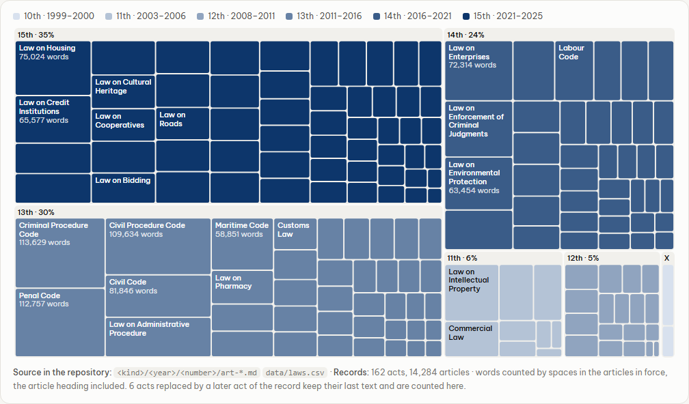

#### 2. Laws per session

The law numbers show how many laws each session adopted: the 10th session of the 15th National Assembly (late 2025) at least 49 laws (Nos. 102 to 150), the 9th 34 laws (Nos. 66 to 99).

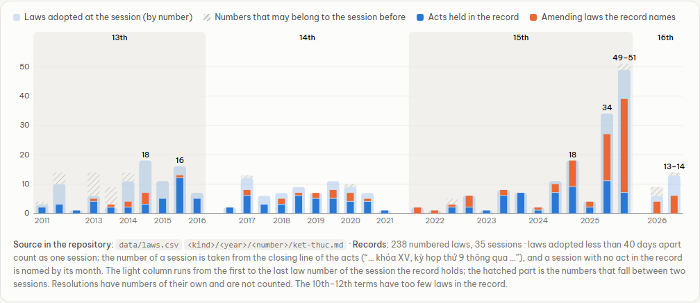

#### 3. Days of adoption and entry into force

Laws are adopted in June and in November–December; 81% of the 513 versions took effect on 1 January or 1 July.

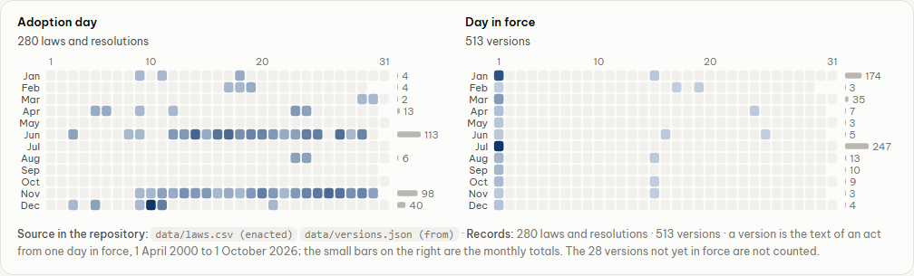

#### 4. From adoption to entry into force

The Law on the Promulgation of Legal Documents of 2025 (Article 53) sets a minimum of 45 days: 32 of the 70 laws adopted since 2025 took effect sooner, against 11 of the 190 before.

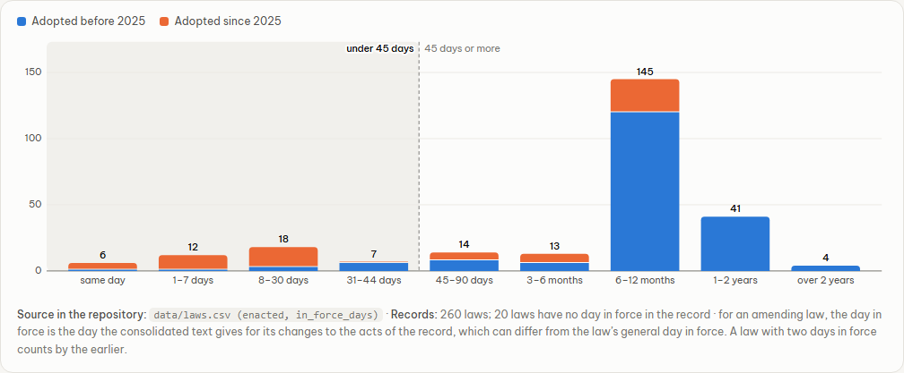

### II. How laws are amended

#### 5. Amendments per year

74% of the 3,757 changes to an article (rewritten, inserted or repealed) took effect in 2025 and 2026, by the kind of law that made them; in 2026, 47% came from laws amending several laws.

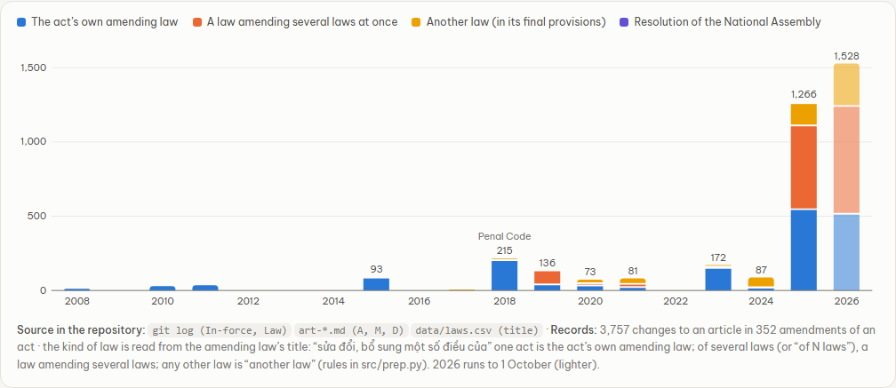

#### 6. One law, many acts

The Cybersecurity Law of 2025 changed 15 other acts of the record; the Law amending 37 laws on planning (2018), 14; the Law amending 15 laws on agriculture and the environment changed 511 articles.

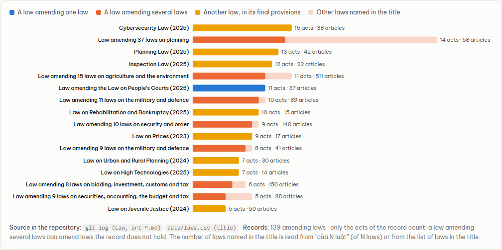

#### 7. Time to the first amendment

A median of 1.0 year for the acts of the 15th National Assembly, 5.0 years for the 14th and 11.5 years for the 10th–12th; 9 acts were amended on their very first day in force.

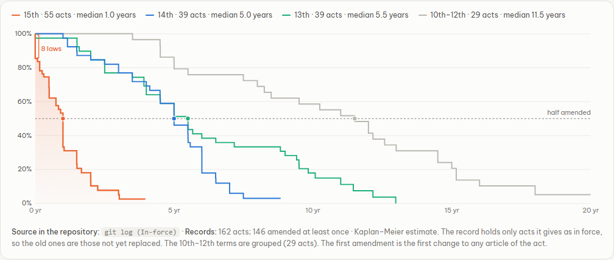

#### 8. Fields and years

Changes to an article by the field of the act and the year they took effect: 411 in civil, criminal and judicial law in 2025, 586 in resources, environment and agriculture in 2026.

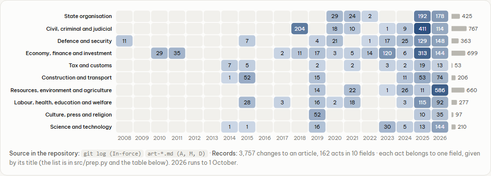

#### 9. Who wrote the text in force

As git blame: 77% of the wording in force of the Law on Health Insurance was written by later laws; 14% across the record, and 16 acts have never been amended.

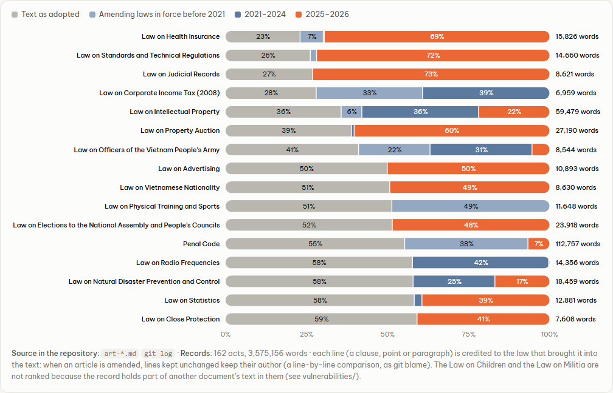

### III. The Constitution and the codes

#### 10. The Constitution of 2013

120 articles in 11 chapters; Resolution 203/2025/QH15 amended 5 of them (Articles 9, 10, 84, 110 and 111); Article 110 now organises administrative units in two levels.

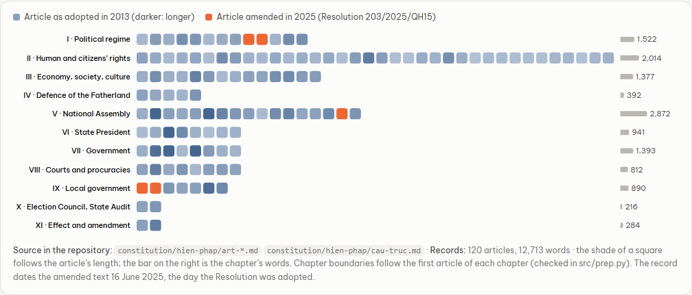

#### 11. The constitution cited

35 acts the record gives as in force still rest on the Constitution of 1992; since June 2025, 13 acts rest on the Constitution of 2013 as amended.

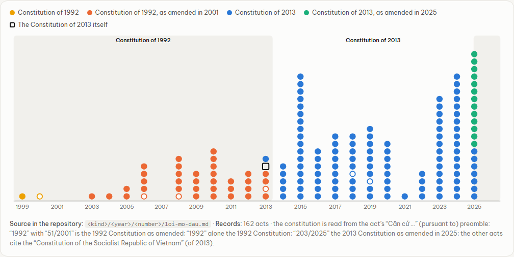

#### 12. The Constitution and the six codes

The Civil Code has never been amended; the Civil Procedure and Criminal Procedure Codes have had 9 versions each; 45% of the Penal Code's wording was written by amending laws.

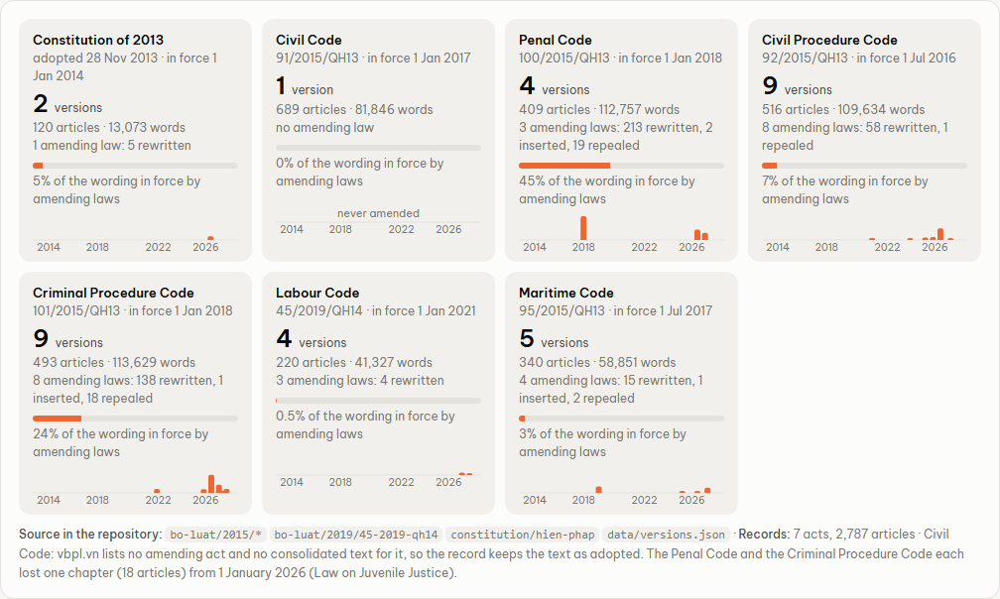

#### 13. Penalties in the Penal Code

The highest penalty of each of its 315 crimes, by chapter: 56 carry life imprisonment or death at most, 109 up to 15 years.

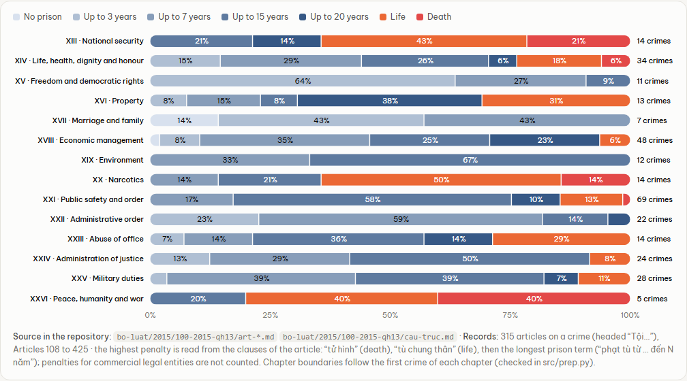

#### 14. The death penalty

From 18 crimes to 10 since 1 July 2025 (Law 86/2025/QH15); the crimes whose highest penalty is life imprisonment rose from 38 to 46.

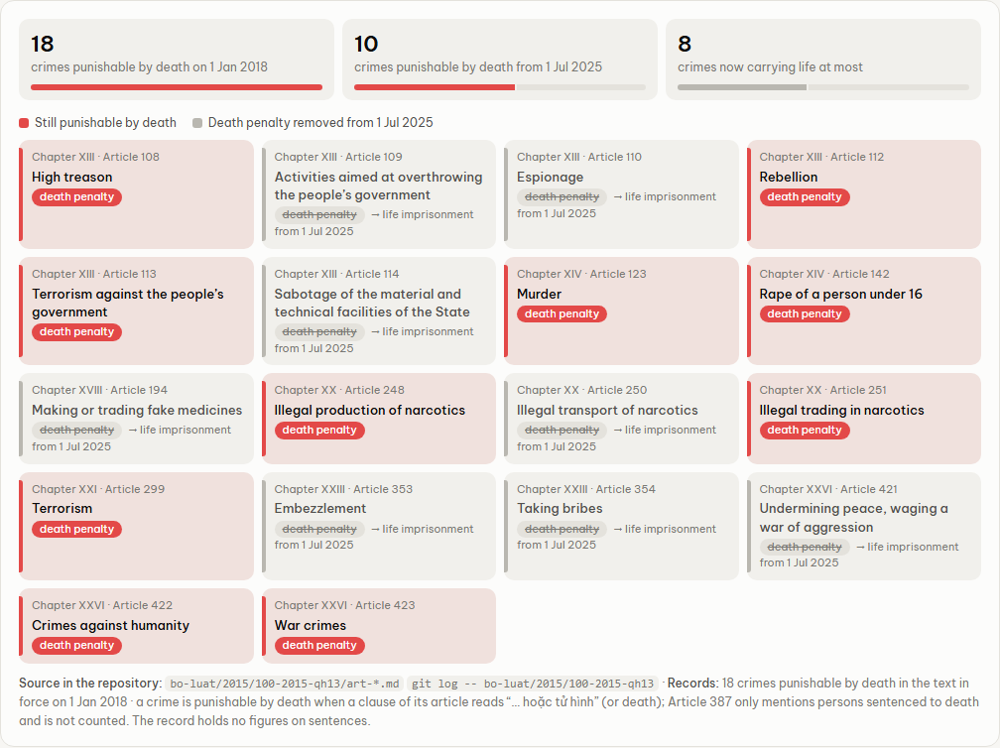

### IV. 2025: reorganising the state

#### 15. The days of change

On 1 July 2025, 60 acts were amended and 14 took effect (939 articles, 23 laws); on 1 January 2026, 34 acts were amended (913 articles).

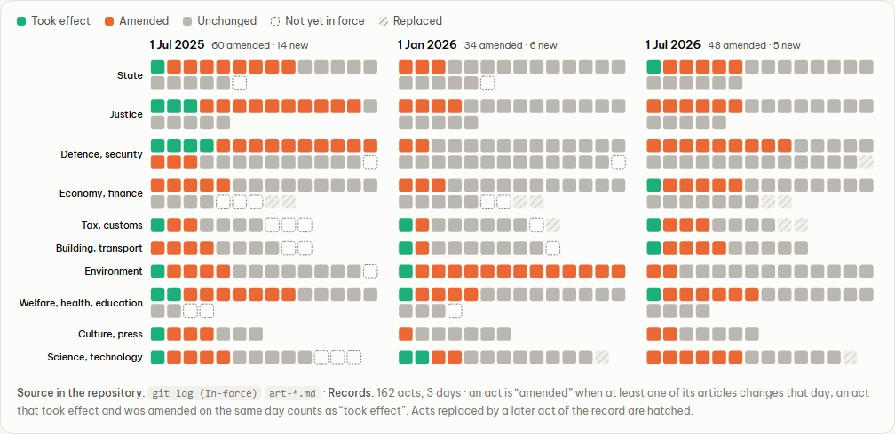

#### 16. “District level”

The phrase “cấp huyện” is still written in 170 articles in force in 27 acts of the record, down from 386 in 2025; “cấp xã” (commune level) is in 531.

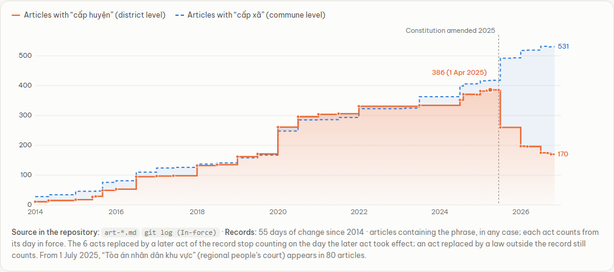

#### 17. Ministry names

The Ministry of Natural Resources and Environment is named in only 12 articles; the Ministry of Labour, Invalids and Social Affairs is still named in 123 and the Ministry of Information and Communications in 127.

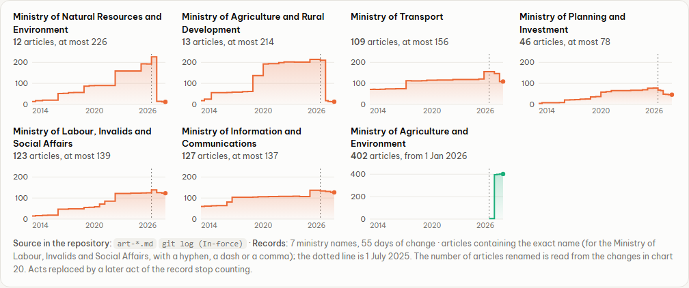

### V. The wording of the law

#### 18. The length of articles

A median of 228 words an article in the acts of the 15th National Assembly, 113 in the 11th; 23% of the 15th's articles run to 400 words or more.

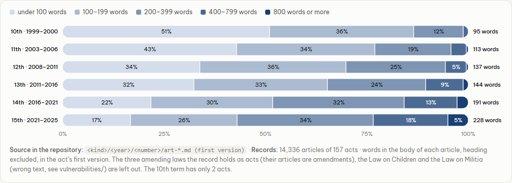

#### 19. Left to the Government

28% of the articles of the 15th National Assembly's acts leave a matter for the Government or the Prime Minister to regulate, against 9% in the 11th; for a minister, 9% against 2%.

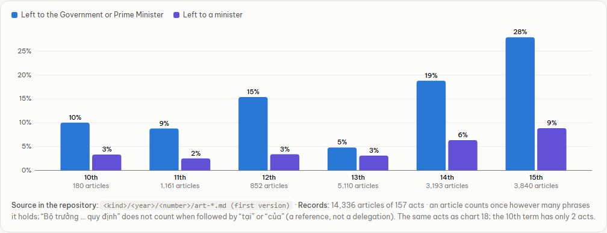

#### 20. The words amended

51% of the changes to an article replace less than 10% of its words; the edits that recur most are ministry names, the district level, townships becoming special zones and tone marks placed the newer way (“hoá” to “hóa”).

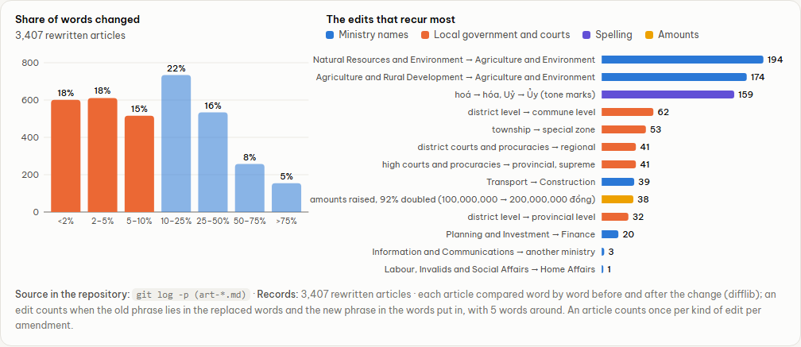

## Data

As of commit `dce20eeefe` (16 November 2026).

| Dataset | Where in the repository | Records | Coverage |
| --- | --- | ---: | --- |
| Acts and articles | `bo-luat/`, `luat/`, `constitution/` (`<kind>/<year>/<number>/art-*.md`) | 162 acts, 14,284 articles | the Constitution of 2013, 6 codes and 155 laws of the National Assembly that the record gives as in force |
| Git history | branch `main` | 369 law commits (162 acts as adopted, 207 amendments) | the date of each commit is the day the version took effect (`In-force:`), 1 April 2000 to 1 October 2026 |
| The laws named | `data/laws.csv` | 280 laws and resolutions | adoption day, day in force, title; 20 laws have no day in force |
| Versions | `data/versions.json` | 513 versions in force, 28 later ones | the later versions (to 1 March 2027) are not commits yet and are not counted |
| Preambles, closing lines, structure | `loi-mo-dau.md`, `ket-thuc.md`, `cau-truc.md` | 162, 144 and 158 files | the constitution cited, the session of adoption, the chapters |

## Limits

- **Only acts of the National Assembly.** Ordinances, resolutions, decrees, circulars and local regulations are not in the record. Chart 2 counts only numbered laws, for the 13th to 16th terms; earlier terms have too few laws in the record.
- **Replaced acts keep their last text.** 6 acts were replaced by a later act of the record (by the later act's final provisions). Charts 16 and 17 stop counting them on the day the later act took effect; the other charts count them. An act replaced by a law the record does not hold cannot be recognised and counts as in force.
- **Two acts hold the wrong text.** The Law on Children and the Law on Militia and Self-defence Forces hold part of another document's text (see [vulnerabilities/](../vulnerabilities/README.en.md)); they are left out of the measures of wording (charts 9, 18 and 19).
- **The day of a change.** Where two laws changed an article and no consolidated text shows it between them, both changes appear on the later law's day (46 articles, `REPRODUCE.md`). The Civil Code is shown as adopted.
- **Classified by rules.** The kind of amending law, the field of each act, the highest penalty, the constitution cited and the edits follow the rules in `src/prep.py`; whatever no rule recognises counts as “other”.
- **2026 is partial** (to 1 October) and drawn lighter.

## Rebuilding

```sh
python visualisations/src/make.py      # history, article texts and tables -> src/.build/ -> phap-luat-viet-nam-qua-20-bieu-do.html
node visualisations/src/stills.cjs     # images for these READMEs (needs Playwright; PLAYWRIGHT=<path> if not global)
```

`make.py` reads everything from git objects, so it also works in a blobless (`--filter=blob:none`) or `--no-checkout` clone, where it downloads in one batch every version of the acts' articles, preambles, closing lines and structure, and the tables in `data/` (about 18,600 small files; never the `vulnerabilities/` folder). It reads `origin/main` (or `HEAD`) by default; `--ref` picks another branch or commit. It writes nothing into the repository except the page and the `src/.build/` folder (which git ignores).

| File | What it does |
| --- | --- |
| `src/make.py` | extracts the history, the tree and the tables into `src/.build/`, fetches the texts a blobless clone lacks, then runs `prep.py` and `build.py` |
| `src/prep.py` | computes every number for the 20 charts and the data profile into `src/.build/data.json` |
| `src/page.tpl.html` | the page: text in both languages, the charts (d3), the tables |
| `src/build.py` | puts `data.json` into the template and writes the page |
| `src/stills.cjs` | draws each chart as a PNG into `stills/vi/` and `stills/en/` |

## Source and licence

The legal text is from vbpl.vn (the national legal database of the Ministry of Justice) and the Official Gazette (congbao.chinhphu.vn). Legal normative documents are not protected by copyright in Vietnam (Luật Sở hữu trí tuệ, Article 15(2)). See [`LICENSE`](../LICENSE).
