# Pháp luật Việt Nam qua 20 biểu đồ

**Tiếng Việt** · [English](README.en.md)

Biểu đồ về pháp luật của mọi quốc gia, từ toàn bộ global-law: [global-law visualisations/](https://github.com/lexifina/global-law/tree/main/visualisations). Trang này chỉ gồm các biểu đồ về Việt Nam.

Hai mươi biểu đồ về pháp luật Việt Nam, vẽ hoàn toàn từ dữ liệu của kho lưu trữ này: 162 văn bản của Quốc hội (Hiến pháp năm 2013, sáu bộ luật và 155 luật), mỗi điều một tệp; 513 phiên bản có hiệu lực từ ngày 1 tháng 4 năm 2000 đến ngày 1 tháng 10 năm 2026, mỗi phiên bản là một commit ghi công cho luật đã sửa; và danh sách 280 luật mà hồ sơ nêu tên, với ngày thông qua và ngày có hiệu lực.

Mở [`phap-luat-viet-nam-qua-20-bieu-do.html`](phap-luat-viet-nam-qua-20-bieu-do.html) bằng trình duyệt. Trang là một tệp duy nhất chứa toàn bộ dữ liệu; nó chỉ tải thư viện d3 và phông chữ từ web. Các nút ở góc trên bên phải đổi ngôn ngữ (tiếng Việt hoặc tiếng Anh) và giao diện (sáng hoặc tối). Mỗi biểu đồ ghi đường dẫn dữ liệu trong kho lưu trữ, số bản ghi và các giới hạn, và có một bảng chứa mọi con số bên dưới. Di chuột lên một điểm để xem giá trị chính xác.

Các biểu đồ chỉ mô tả: chúng cho thấy hồ sơ ghi lại những gì, không giải thích vì sao.

## Các biểu đồ

### I. Quốc hội làm luật

#### 1. Kích thước của hồ sơ

162 văn bản với 3,58 triệu từ đang có hiệu lực, theo khóa Quốc hội đã thông qua: 35% do khóa XV, 30% do khóa XIII; dài nhất là Bộ luật Tố tụng hình sự (113.629 từ).

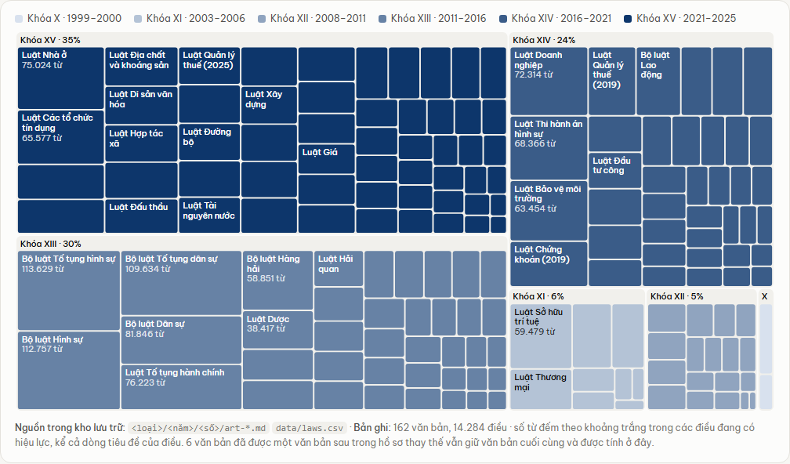

#### 2. Số luật mỗi kỳ họp

Số hiệu luật cho biết mỗi kỳ họp đã thông qua bao nhiêu luật: kỳ họp thứ 10 khóa XV (cuối năm 2025) ít nhất 49 luật (số 102 đến 150), kỳ họp thứ 9 là 34 luật (số 66 đến 99).

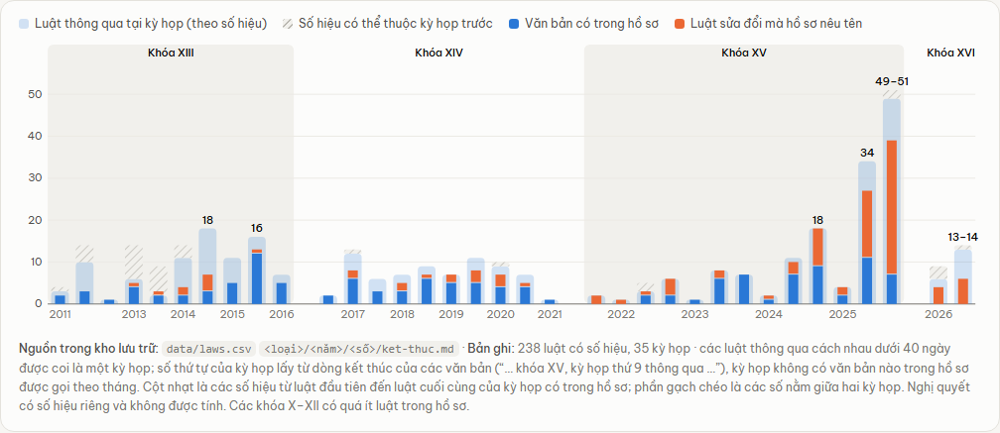

#### 3. Ngày thông qua và ngày có hiệu lực

Luật được thông qua vào tháng 6 và tháng 11–12; 81% trong 513 phiên bản có hiệu lực vào ngày 1 tháng 1 hoặc ngày 1 tháng 7.

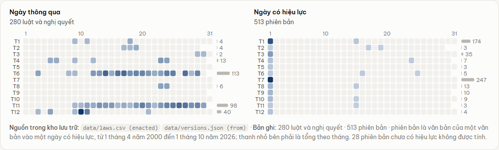

#### 4. Từ thông qua đến có hiệu lực

Luật Ban hành văn bản quy phạm pháp luật năm 2025 (Điều 53) đặt mức tối thiểu 45 ngày: 32 trong 70 luật thông qua từ năm 2025 có hiệu lực sớm hơn, so với 11 trong 190 luật trước đó.

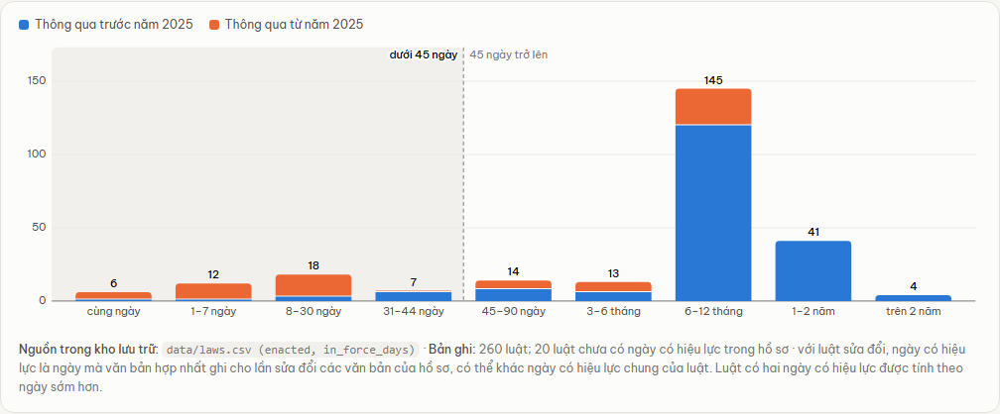

### II. Luật được sửa như thế nào

#### 5. Số lần sửa mỗi năm

74% trong 3.757 lần một điều được sửa, bổ sung hoặc bãi bỏ có hiệu lực trong hai năm 2025 và 2026, theo loại luật đã sửa; năm 2026, 47% do luật sửa đổi nhiều luật.

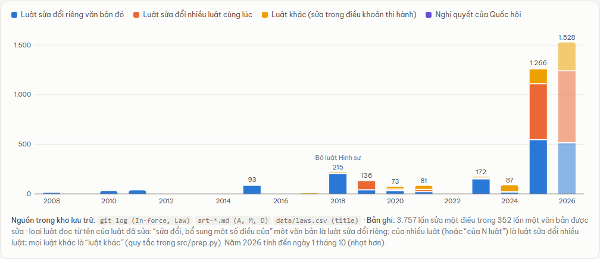

#### 6. Một luật sửa nhiều văn bản

Luật An ninh mạng năm 2025 sửa 15 văn bản khác của hồ sơ; Luật sửa đổi 37 luật liên quan đến quy hoạch (2018) sửa 14; Luật sửa đổi 15 luật về nông nghiệp và môi trường sửa 511 điều.

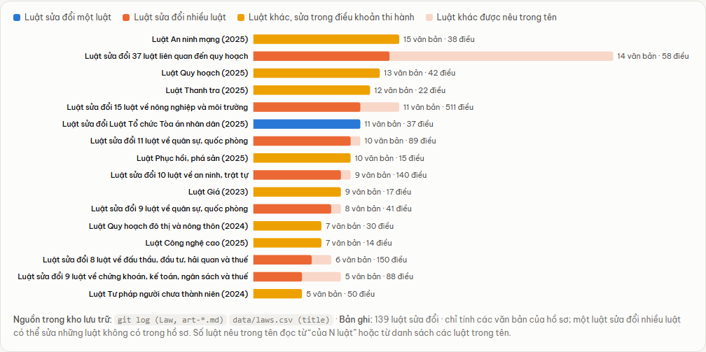

#### 7. Bao lâu thì được sửa lần đầu

Trung vị 1,0 năm với văn bản khóa XV, 5,0 năm với khóa XIV và 11,5 năm với các khóa X–XII; 9 văn bản bị sửa ngay ngày đầu tiên có hiệu lực.

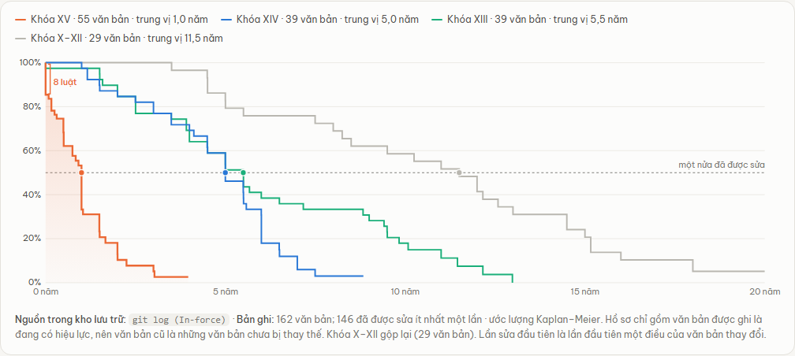

#### 8. Lĩnh vực và năm

Số lần sửa một điều theo lĩnh vực của văn bản và năm có hiệu lực: 411 trong lĩnh vực dân sự, hình sự và tư pháp năm 2025, 586 trong lĩnh vực tài nguyên, môi trường và nông nghiệp năm 2026.

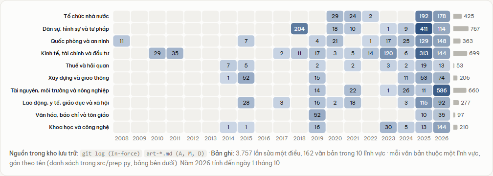

#### 9. Ai viết văn bản hiện hành

Như git blame: 77% câu chữ hiện hành của Luật Bảo hiểm y tế do các luật sau viết; trên toàn hồ sơ là 14%, và 16 văn bản chưa từng được sửa.

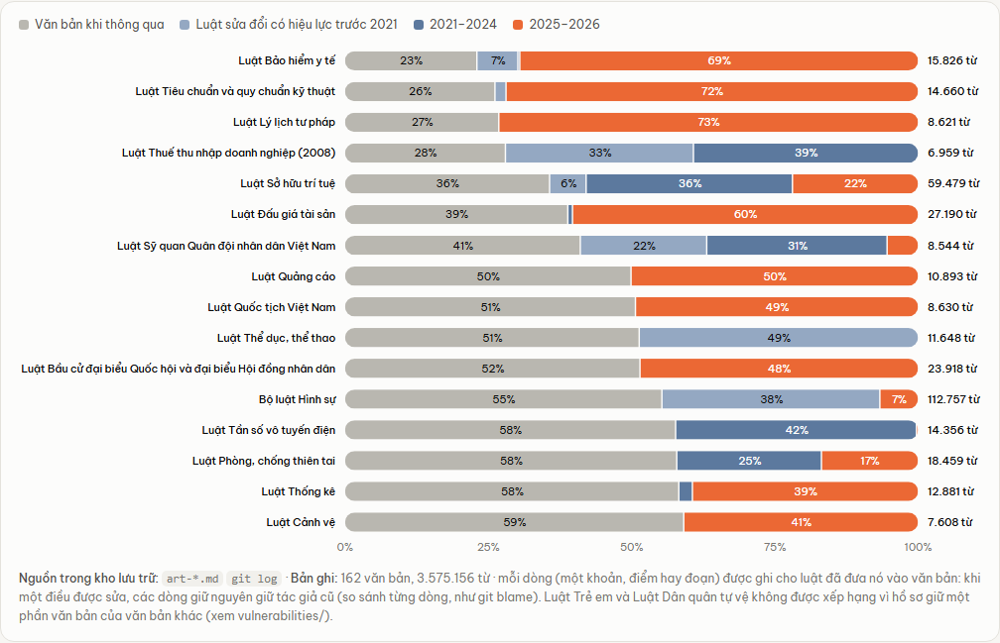

### III. Hiến pháp và các bộ luật

#### 10. Hiến pháp năm 2013

120 điều trong 11 chương; Nghị quyết 203/2025/QH15 sửa 5 điều (Điều 9, 10, 84, 110 và 111); Điều 110 nay tổ chức đơn vị hành chính thành hai cấp.

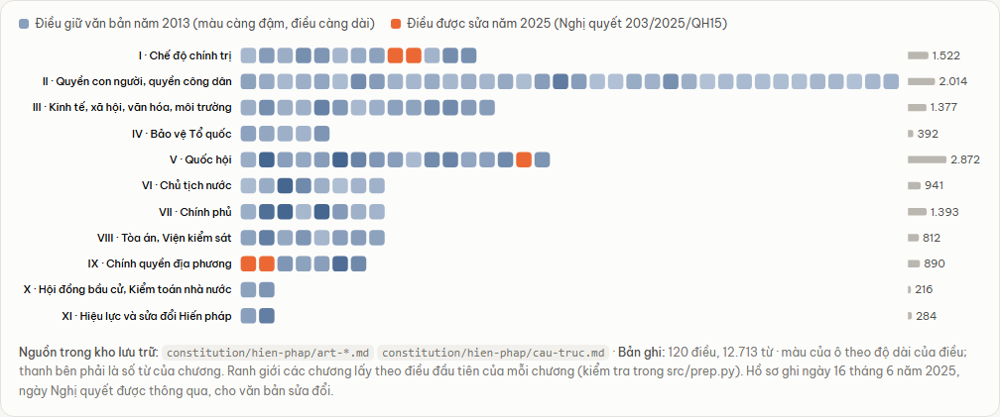

#### 11. Hiến pháp được viện dẫn

35 văn bản mà hồ sơ ghi là đang có hiệu lực vẫn căn cứ Hiến pháp năm 1992; từ tháng 6 năm 2025, 13 văn bản căn cứ Hiến pháp năm 2013 đã được sửa đổi.

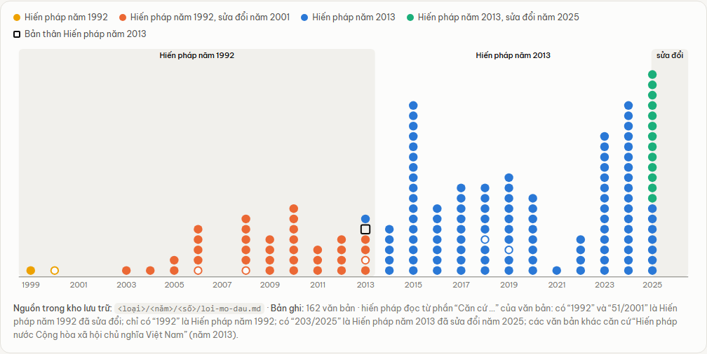

#### 12. Hiến pháp và sáu bộ luật

Bộ luật Dân sự chưa được sửa lần nào; Bộ luật Tố tụng dân sự và Bộ luật Tố tụng hình sự đã có 9 phiên bản; 45% câu chữ của Bộ luật Hình sự do luật sửa đổi viết.

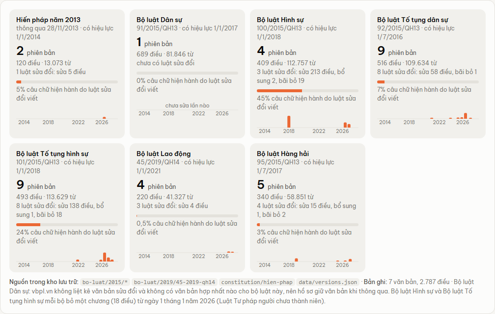

#### 13. Hình phạt trong Bộ luật Hình sự

Mức hình phạt cao nhất của 315 tội, theo chương: 56 tội có mức cao nhất là tù chung thân hoặc tử hình, 109 tội là tù đến 15 năm.

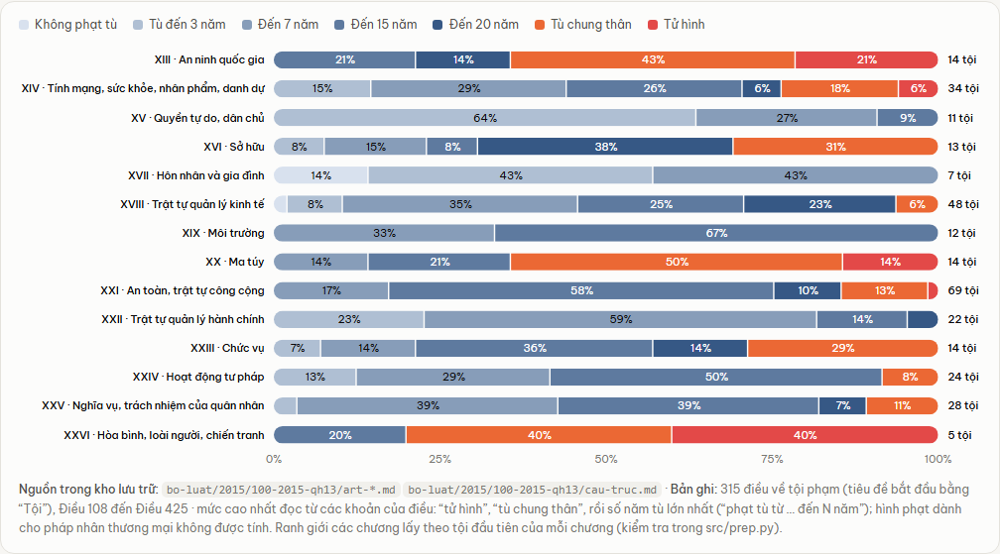

#### 14. Tử hình

Từ 18 tội còn 10 tội kể từ ngày 1 tháng 7 năm 2025 (Luật 86/2025/QH15); số tội có mức cao nhất là tù chung thân tăng từ 38 lên 46.

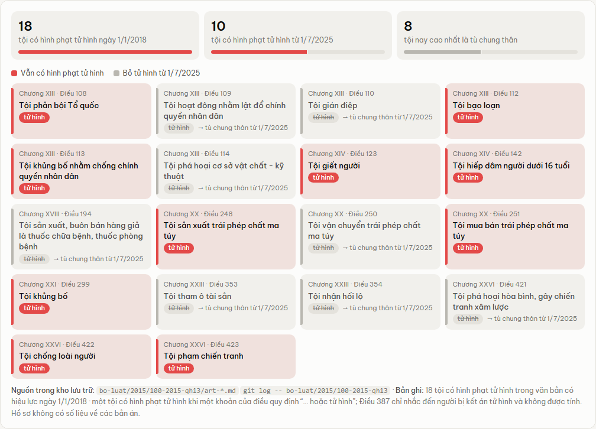

### IV. Năm 2025: sắp xếp lại bộ máy

#### 15. Những ngày thay đổi

Ngày 1 tháng 7 năm 2025, 60 văn bản được sửa và 14 văn bản bắt đầu có hiệu lực (939 điều, 23 luật); ngày 1 tháng 1 năm 2026, 34 văn bản được sửa (913 điều).

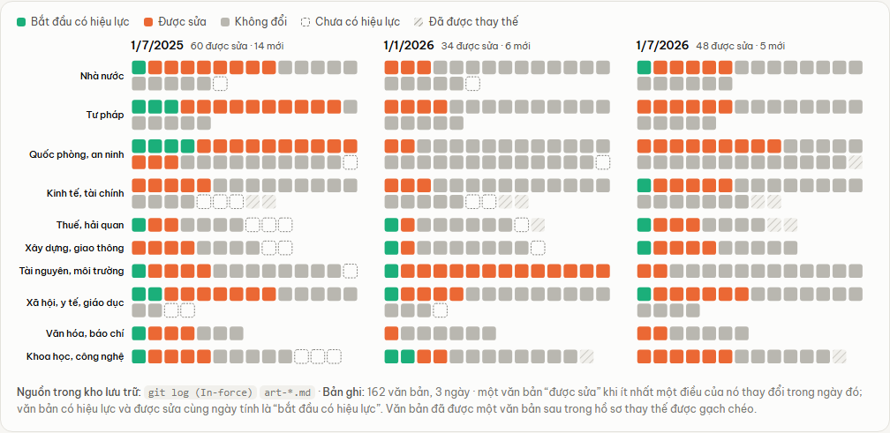

#### 16. “Cấp huyện”

Cụm từ vẫn còn trong 170 điều luật đang có hiệu lực của 27 văn bản trong hồ sơ, giảm từ 386 điều năm 2025; “cấp xã” có trong 531 điều.

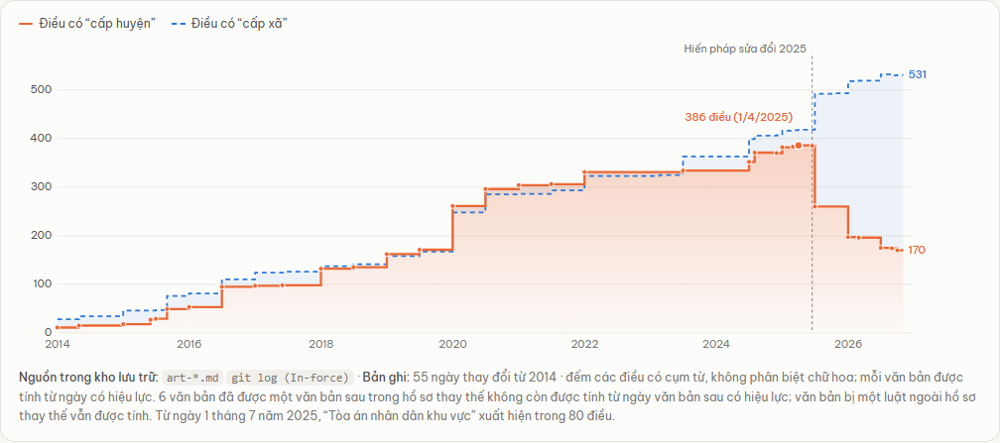

#### 17. Tên các bộ

“Bộ Tài nguyên và Môi trường” chỉ còn trong 12 điều; “Bộ Lao động - Thương binh và Xã hội” vẫn có trong 123 điều, “Bộ Thông tin và Truyền thông” trong 127 điều.

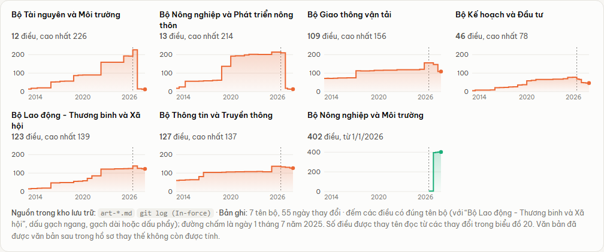

### V. Câu chữ của luật

#### 18. Độ dài của điều luật

Trung vị 228 từ một điều ở các văn bản khóa XV, 113 từ ở khóa XI; 23% số điều của khóa XV dài từ 400 từ trở lên.

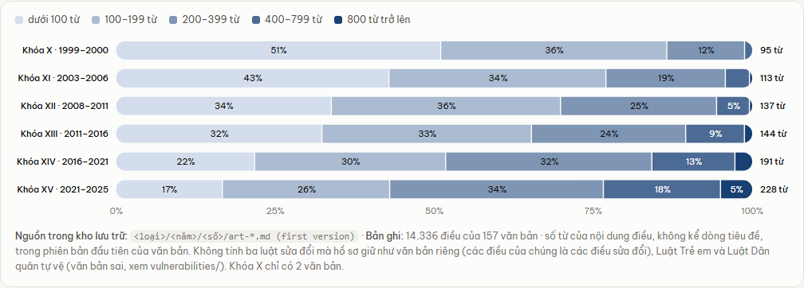

#### 19. Giao Chính phủ quy định

28% số điều của các văn bản khóa XV giao cho Chính phủ hoặc Thủ tướng quy định, so với 9% ở khóa XI; giao cho bộ trưởng: 9% so với 2%.

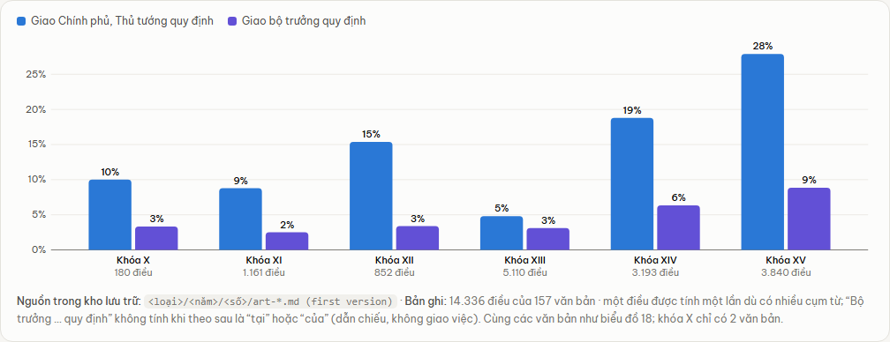

#### 20. Những chữ được sửa

51% số lần sửa một điều thay chưa đến 10% số từ; những thay đổi lặp lại nhiều nhất là tên bộ, “cấp huyện”, “thị trấn” thành “đặc khu” và dấu thanh kiểu mới (“hoá” thành “hóa”).

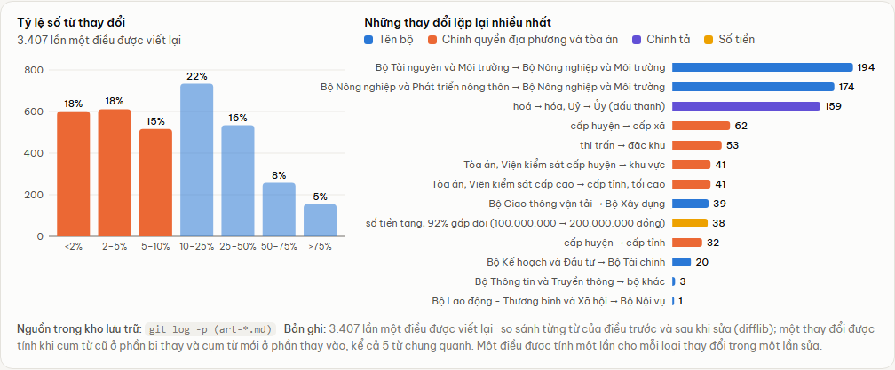

## Dữ liệu

Theo commit `dce20eeefe` (16 tháng 11 năm 2026).

| Dữ liệu | Vị trí trong kho lưu trữ | Bản ghi | Phạm vi |
| --- | --- | ---: | --- |
| Văn bản và điều | `bo-luat/`, `luat/`, `constitution/` (`<loại>/<năm>/<số>/art-*.md`) | 162 văn bản, 14.284 điều | Hiến pháp năm 2013, 6 bộ luật và 155 luật của Quốc hội đang được ghi là có hiệu lực |
| Lịch sử git | nhánh `main` | 369 commit luật (162 văn bản khi thông qua, 207 lần sửa) | ngày của mỗi commit là ngày phiên bản có hiệu lực (`In-force:`), từ 1/4/2000 đến 1/10/2026 |
| Danh sách luật | `data/laws.csv` | 280 luật và nghị quyết | ngày thông qua, ngày có hiệu lực, tên; 20 luật chưa có ngày có hiệu lực |
| Phiên bản | `data/versions.json` | 513 phiên bản có hiệu lực, 28 phiên bản về sau | các phiên bản về sau (đến 1/3/2027) chưa phải commit và không được tính |
| Lời nói đầu, dòng kết thúc, cấu trúc | `loi-mo-dau.md`, `ket-thuc.md`, `cau-truc.md` | 162, 144 và 158 tệp | hiến pháp được viện dẫn, kỳ họp thông qua, các chương |

## Giới hạn

- **Chỉ có văn bản của Quốc hội.** Pháp lệnh, nghị quyết, nghị định, thông tư và văn bản của địa phương không có trong hồ sơ. Biểu đồ 2 chỉ tính các luật có số hiệu, cho các khóa XIII–XVI; các khóa trước có quá ít luật trong hồ sơ.
- **Văn bản đã bị thay thế vẫn giữ văn bản cuối cùng.** 6 văn bản được một văn bản sau trong hồ sơ thay thế (theo điều khoản thi hành của văn bản sau). Biểu đồ 16 và 17 không tính chúng từ ngày văn bản sau có hiệu lực; các biểu đồ khác vẫn tính. Văn bản bị một luật không có trong hồ sơ thay thế thì không nhận ra được và vẫn được tính như đang có hiệu lực.
- **Hai văn bản giữ văn bản sai.** Luật Trẻ em và Luật Dân quân tự vệ giữ một phần văn bản của văn bản khác (xem [vulnerabilities/](../vulnerabilities/)); hai luật này không được tính trong các số đo về câu chữ (biểu đồ 9, 18 và 19).
- **Ngày của thay đổi.** Khi hai luật cùng sửa một điều mà không có văn bản hợp nhất nào ở giữa, cả hai thay đổi hiện vào ngày của luật sau (46 điều, `REPRODUCE.md`). Bộ luật Dân sự được giữ như khi thông qua.
- **Phân loại theo quy tắc.** Loại luật sửa đổi, lĩnh vực của văn bản, hình phạt cao nhất, hiến pháp được viện dẫn và các thay đổi về câu chữ theo các quy tắc trong `src/prep.py`; điều gì không quy tắc nào nhận ra thì tính là “khác”.
- **Năm 2026 chưa hết** (đến ngày 1 tháng 10) và được vẽ nhạt hơn.

## Dựng lại

```sh
python visualisations/src/make.py      # lịch sử, văn bản các điều và các bảng -> src/.build/ -> phap-luat-viet-nam-qua-20-bieu-do.html
node visualisations/src/stills.cjs     # hình cho các README (cần Playwright; PLAYWRIGHT=<thư mục> nếu không cài toàn cục)
```

`make.py` đọc mọi thứ từ các đối tượng git, nên cũng chạy được trong bản sao không có blob (`--filter=blob:none`) hoặc `--no-checkout`; khi đó nó tải về trong một lần mọi phiên bản của các điều, lời nói đầu, dòng kết thúc và cấu trúc của các văn bản cùng các bảng trong `data/` (khoảng 18.600 tệp nhỏ, không tải thư mục `vulnerabilities/`). Mặc định nó đọc `origin/main` (hoặc `HEAD`); `--ref` chọn nhánh hoặc commit khác. Nó không ghi gì vào kho lưu trữ ngoài trang và thư mục `src/.build/` (git bỏ qua).

| Tệp | Chức năng |
| --- | --- |
| `src/make.py` | trích lịch sử, cây thư mục và các bảng vào `src/.build/`, tải các văn bản còn thiếu, rồi chạy `prep.py` và `build.py` |
| `src/prep.py` | tính mọi con số của 20 biểu đồ và hồ sơ dữ liệu vào `src/.build/data.json` |
| `src/page.tpl.html` | trang: chữ bằng hai ngôn ngữ, các biểu đồ (d3), các bảng |
| `src/build.py` | đưa `data.json` vào mẫu và ghi trang |
| `src/stills.cjs` | vẽ từng biểu đồ thành ảnh PNG trong `stills/vi/` và `stills/en/` |

## Nguồn và giấy phép

Văn bản pháp luật lấy từ vbpl.vn (Cơ sở dữ liệu quốc gia về pháp luật, Bộ Tư pháp) và Công báo (congbao.chinhphu.vn). Văn bản quy phạm pháp luật không thuộc đối tượng bảo hộ quyền tác giả tại Việt Nam (Luật Sở hữu trí tuệ, Điều 15 khoản 2). Xem [`LICENSE`](../LICENSE).
