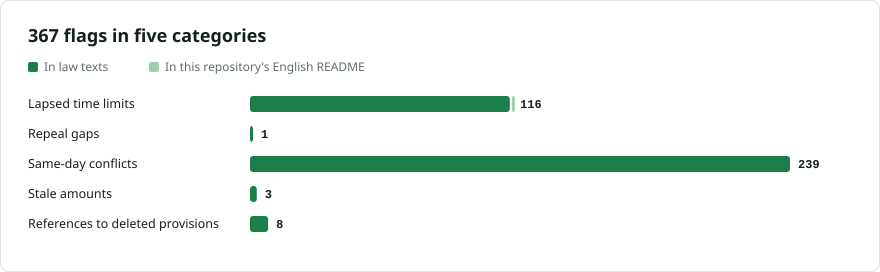

# Vulnerabilities in Vietnamese law

[Tiếng Việt](README.md) · **English**

<picture>
<source media="(prefers-color-scheme: dark)" srcset="img/flags-by-category-dark.svg">

</picture>

The vulnerability detectors from [lexifina/global-law](https://github.com/lexifina/global-law/tree/main/vulnerabilities) look for mechanical mistakes in legislation: a rule applying "until" a date that has passed, a provision repealed before its replacement took effect, two amendments to the same provision on the same day, an amount changed in one place but not another, a reference to an article that no longer exists. global-law's published list (9 November 2026) did not include Vietnam, so this is a run over this repository only, as it stood at commit [`851db24`](https://github.com/lexifina/vietnam-law/commit/851db24da020e03409223e1cb1e30a0178298dad) on 16 November 2026: the Constitution, the six codes and 155 laws of the National Assembly.

**In short:** the detectors raised 367 flags. A language model reviewed 92 of the strongest, arguing each one for and against; 6 survived. Read by hand in this repository, none of the six is a mistake in the law: three are Penal Code articles that this repository dates twice to 1 January 2018 (the Code as enacted and as amended by Law No. 12/2017/QH14 before it took effect), two are lawful cut-off dates, and one compares a procurement threshold with an unrelated amount in other laws. The model set aside all eight references to deleted articles; read by hand, three of them look like possible slips, each to be confirmed against the amending law's own text, which this repository does not hold. Article 29(2)(c) of the Telecommunications Law (24/2023/QH15) still requires data-centre and cloud providers to comply with "clause 3 of Article 8", which the Planning Law 112/2025/QH15 repealed from 1 March 2026; the Cybersecurity Law 116/2025/QH15 later amended point (b) of the same clause and left point (c). Article 50(1)(c) of the Crop Production Law (31/2018/QH14) still lets fertiliser producers advertise "as provided in Article 49", which Law No. 146/2025/QH15 repealed from 1 January 2026. Article 101(1)(b) of the PPP Law (64/2020/QH14) still refers to clause 6 of Article 23, which Law No. 90/2025/QH15 repealed from 1 July 2025 while amending Article 101 itself. The hand check also found two acts in this repository that hold another document's text (below). Later, this will be formalised in Lean, similar to our work on [the US tax code](https://lexifina.com/blog/formalizing-the-us-tax-code) and [US case law](https://lexifina.com/blog/formalizing-all-us-case-law-in-lean).

A flag is a prompt to look, not legal advice, and nothing here has been tested in court.

## Flags by category

| Category | What it looks for | Flags | In law texts | Reviewed | Survived review |
| --- | --- | ---: | ---: | ---: | ---: |
| Lapsed time limits | Text still applying a rule "until" a date that has passed | 116 | 115 | 40 | 2 |
| Repeal gaps | A provision removed before its replacement took effect | 1 | 1 | 1 | 0 |
| Same-day conflicts | Two acts changing the same provision on the same day | 239 | 239 | 40 | 3 |
| Stale amounts | An amount changed in one place but still standing elsewhere | 3 | 3 | 3 | 1 |
| References to deleted provisions | A provision citing an article that no longer exists | 8 | 8 | 8 | 0 |

"In law texts" counts the Constitution, the codes and the laws. The one other flag is in this repository's English README, which describes the record ("until 11 November 2026 each folder was named by the act's id"). global-law's detectors did not read Vietnamese before this run; they now read dates written "ngày 31 tháng 12 năm 2020" or "31/12/2020" after "đến", "đến hết", "cho đến", "trước" (before) and "chậm nhất là" (at the latest), and the end of a year ("đến hết năm 2020"), counting "trước" and "chậm nhất" as deadlines. In law texts they read every such date written in full (127 phrases with a year up to 2026); they leave out "tính đến" (as at, 3) and a bare year ("trước năm 2014", 19), which set no time limit. They also read references to articles ("Điều 12", "khoản 2 Điều 5", "điểm a khoản 1 Điều 3", "từ Điều 8 đến Điều 26"), not counting those followed by another act's name ("Điều 15 của Luật Sở hữu trí tuệ"), and amounts in đồng ("5.000.000 đồng", "100 triệu đồng"). 74 of the lapsed time limits follow "trước": most are the cut-off of a transitional rule, not a time limit. The searches for retroactive dates, empty periods, references to repealed placeholders, dead fines, duplicate numbering, dead currencies and publisher notes found nothing: no amendment here moved a time limit after it had run out (one, Article 157 of the Insurance Business Law, moved 31 December 2025 to 30 June 2026 from 1 January 2026, the day after), and repealed articles are deleted rather than kept as placeholders (one exception, Article 105 of 15/2017/QH14, is cited nowhere).

*Edge cases: the six flags that survived the review and the eight references to deleted articles, grouped by what they turned out to be, and what the other flags are, in [EDGE-CASES.en.md](EDGE-CASES.en.md).*

## Problems found in this repository

- **The Militia and Self-Defence Forces Law holds another law's text.** From [1 July 2025](https://github.com/lexifina/vietnam-law/commit/32a4d8687cd3f6cd36f951fb26d57b6d67a3ecef) (credited to Law No. 98/2025/QH15), 21 of the article files of [Luật Dân quân tự vệ](https://github.com/lexifina/vietnam-law/tree/851db24da020e03409223e1cb1e30a0178298dad/luat/2019/48-2019-qh14) (48/2019/QH14) hold provisions on military service rather than on the militia, and still do at commit `851db24`: Articles 3, 4, 10, 13, 15 to 19, 28, 29, 34 to 36, 39, 40, 42, 44, 47, 49 and 56, for example Article 4 "Nghĩa vụ quân sự", Article 16 "Đăng ký nghĩa vụ quân sự lần đầu" and Article 36 "Hội đồng nghĩa vụ quân sự". The same commit deleted Article 38 (local spending duties) and replaced Article 37 with "Nhiệm vụ của Hội đồng nghĩa vụ quân sự cấp tỉnh"; Law No. 14/2026/QH16 [brought both back](https://github.com/lexifina/vietnam-law/commit/61cac055eb3d3a709c3515e19dff487fbce90c0e) from 1 September 2026, which the repeal-gap detector read as 427 days without Article 38.
- **The Children's Law holds a 2024 amnesty decision.** The first version of [Luật Trẻ em](https://github.com/lexifina/vietnam-law/tree/851db24da020e03409223e1cb1e30a0178298dad/luat/2016/102-2016-qh13) (102/2016/QH13), dated [1 June 2017](https://github.com/lexifina/vietnam-law/commit/57477aa0ad1e920b17236f6e4ae83d71abfd2c15), is the seven articles and preamble of a decision on amnesty for the 79th National Day (2 September 2024), "Quyết định này có hiệu lực kể từ ngày ký ban hành". Articles 1 to 4 and 6 and the preamble are still that decision; the folder holds 9 other articles of the Children's Law (5, 7, 45, 57, 66, 71, 74, 79 and 82), those that later amending acts changed, and none of the rest.

## Files

| File | What it holds |
| --- | --- |
| [data/flags.csv](data/flags.csv) | Every flag, one row per provision and issue |
| [data/reviewed.csv](data/reviewed.csv) | The 92 flags the model reviewed, with its verdict and reason |
| [data/by_category.csv](data/by_category.csv) | The counts in the table above |
| [tools/](tools/) | The scripts that made this run |

Columns: `category` and `category_vi` (the category in English and Vietnamese), `detector`, `kind` (`law` or `other`), `path` (the file in this repository), `date` (the date the flag turns on), `reference` (the act or line involved), `summary`, `score` (the detector's ranking, 0 to 1), `review` (`artefact`, `lawful` or `candidate_defect`), `survives_rebuttal`, `review_note` (the model's reason, in English), `url` (the provision at the commit that was read, or, for an article deleted since, at the last commit that held it).

## How it was made

- **Detectors:** global-law's [vulnerabilities/scripts](https://github.com/lexifina/global-law/tree/main/vulnerabilities/scripts), run on this repository at commit `851db24`. global-law replays this repository only up to an earlier commit, so the history table the detectors read was built from this repository's own commits (the author, the act that made each change, and the `In-force` and `Kind` trailers). Act folders were renamed on 11 November 2026 (`bo-luat-lao-dong/` to `bo-luat/2019/45-2019-qh14/`), so every earlier path was mapped to its folder today through `data/paths.json` before the scans; without this, an act's history ended at the move and no reference could be checked. The date, reference and amount searches were taught Vietnamese for this run.
- **Model review:** gpt-5.4-mini, the 40 strongest flags per category, and for lapsed time limits also the 40 strongest in law texts (the same 40 here); one pass says whether a flag is real, a second argues that it is not. Categories with fewer flags were reviewed in full. Where a flag was reviewed twice, the later review is kept. global-law's own list used a different model.
- **Hand check:** every flag that survived, and all eight references to deleted articles, were read in this repository's history and texts; the other reviewed flags were read in the passage the detector quoted, and the unreviewed ones by sample. This repository does not hold the amending laws 90/2025, 112/2025 and 146/2025 themselves, so the three possible slips rest on the consolidated texts this repository follows and still need the Công báo.

To report a correction, open an issue with the provision and an official source.

## Licence

The lists and notes are Lexifina's, dedicated to the public domain under CC0 1.0, like the rest of this repository's own contributions. Quoted law text is as vbpl.vn and the Công báo publish it; legal normative documents are not protected by copyright in Vietnam (Article 15(2) of the Law on Intellectual Property 50/2005/QH11); see [LICENSE](../LICENSE).
