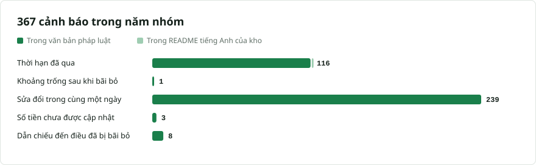

# Lỗ hổng trong pháp luật Việt Nam

**Tiếng Việt** · [English](README.en.md)

<picture>
<source media="(prefers-color-scheme: dark)" srcset="img/flags-by-category-dark.vi.svg">

</picture>

Các bộ phát hiện lỗ hổng của [lexifina/global-law](https://github.com/lexifina/global-law/tree/main/vulnerabilities) tìm những sai sót mang tính kỹ thuật trong văn bản pháp luật: một quy định vẫn áp dụng "đến" một ngày đã qua, một điều bị bãi bỏ trước khi quy định thay thế có hiệu lực, hai lần sửa đổi cùng một điều trong cùng một ngày, một số tiền được sửa ở chỗ này nhưng không được sửa ở chỗ khác, một dẫn chiếu đến điều không còn tồn tại. Danh sách mà global-law công bố (ngày 9 tháng 11 năm 2026) không có Việt Nam, vì vậy đây là lần chạy chỉ trên kho lưu trữ này, ở commit [`851db24`](https://github.com/lexifina/vietnam-law/commit/851db24da020e03409223e1cb1e30a0178298dad) ngày 16 tháng 11 năm 2026: Hiến pháp, sáu bộ luật và 155 luật của Quốc hội.

**Tóm lại:** các bộ phát hiện đưa ra 367 cảnh báo. Một mô hình ngôn ngữ đã xem xét 92 cảnh báo mạnh nhất, lập luận cả ủng hộ lẫn phản bác từng cảnh báo; còn lại 6. Khi đọc thủ công trong kho lưu trữ này, không cảnh báo nào trong sáu cảnh báo đó là sai sót của pháp luật: ba cảnh báo là các điều của Bộ luật Hình sự mà kho này ghi hai phiên bản cùng vào ngày 1 tháng 1 năm 2018 (bộ luật khi được thông qua và khi đã được sửa đổi bởi Luật số 12/2017/QH14 trước khi có hiệu lực), hai cảnh báo là mốc thời gian hợp pháp, và một cảnh báo so sánh ngưỡng chỉ định thầu với một số tiền không liên quan trong các luật khác. Mô hình đã gạt bỏ cả tám dẫn chiếu đến điều đã bị bãi bỏ; khi đọc thủ công, ba dẫn chiếu có thể là sơ suất, mỗi trường hợp cần được đối chiếu với chính văn bản của luật sửa đổi, mà kho này không lưu giữ. Điểm c khoản 2 Điều 29 Luật Viễn thông (24/2023/QH15) vẫn buộc doanh nghiệp cung cấp dịch vụ trung tâm dữ liệu, điện toán đám mây thực hiện "khoản 3 Điều 8", điều đã bị Luật Quy hoạch số 112/2025/QH15 bãi bỏ từ ngày 1 tháng 3 năm 2026; sau đó Luật An ninh mạng số 116/2025/QH15 sửa đổi điểm b của cùng khoản này nhưng giữ nguyên điểm c. Điểm c khoản 1 Điều 50 Luật Trồng trọt (31/2018/QH14) vẫn cho phép tổ chức, cá nhân sản xuất phân bón quảng cáo "theo quy định tại Điều 49", điều đã bị Luật số 146/2025/QH15 bãi bỏ từ ngày 1 tháng 1 năm 2026. Điểm b khoản 1 Điều 101 Luật Đầu tư theo phương thức đối tác công tư (64/2020/QH14) vẫn dẫn chiếu khoản 6 Điều 23, điều đã bị Luật số 90/2025/QH15 bãi bỏ từ ngày 1 tháng 7 năm 2025, trong khi chính luật này sửa đổi Điều 101. Việc kiểm tra thủ công cũng phát hiện hai văn bản trong kho này chứa nội dung của văn bản khác (xem dưới đây). Về sau, những kết quả này sẽ được hình thức hóa trong Lean, tương tự công việc của chúng tôi về [Bộ luật Thuế Hoa Kỳ](https://lexifina.com/blog/formalizing-the-us-tax-code) và [án lệ Hoa Kỳ](https://lexifina.com/blog/formalizing-all-us-case-law-in-lean).

Một cảnh báo chỉ là gợi ý để xem xét, không phải tư vấn pháp lý, và chưa có nội dung nào ở đây được kiểm chứng tại tòa án.

## Cảnh báo theo nhóm

| Nhóm | Nội dung tìm kiếm | Cảnh báo | Trong văn bản pháp luật | Đã xem xét | Còn lại sau xem xét |
| --- | --- | ---: | ---: | ---: | ---: |
| Thời hạn đã qua | Văn bản vẫn áp dụng một quy định "đến" một ngày đã qua | 116 | 115 | 40 | 2 |
| Khoảng trống sau khi bãi bỏ | Một điều bị bỏ trước khi quy định thay thế có hiệu lực | 1 | 1 | 1 | 0 |
| Sửa đổi trong cùng một ngày | Hai văn bản cùng sửa đổi một điều trong cùng một ngày | 239 | 239 | 40 | 3 |
| Số tiền chưa được cập nhật | Một số tiền được sửa ở một chỗ nhưng vẫn còn ở chỗ khác | 3 | 3 | 3 | 1 |
| Dẫn chiếu đến điều đã bị bãi bỏ | Một điều dẫn chiếu đến điều không còn tồn tại | 8 | 8 | 8 | 0 |

"Trong văn bản pháp luật" tính Hiến pháp, các bộ luật và các luật. Cảnh báo còn lại nằm trong README tiếng Anh của kho này, phần mô tả hồ sơ ("until 11 November 2026 each folder was named by the act's id"). Trước lần chạy này, các bộ phát hiện của global-law không đọc được tiếng Việt; nay chúng đọc các ngày viết dạng "ngày 31 tháng 12 năm 2020" hoặc "31/12/2020" sau "đến", "đến hết", "cho đến", "trước" và "chậm nhất là", cũng như cuối một năm ("đến hết năm 2020"), và coi "trước" và "chậm nhất" là thời hạn phải hoàn thành. Trong văn bản pháp luật, chúng đọc được mọi ngày viết đầy đủ như vậy (127 cụm từ có năm đến 2026); chúng bỏ qua "tính đến" (3) và năm đứng một mình ("trước năm 2014", 19), vốn không đặt ra thời hạn. Chúng cũng đọc các dẫn chiếu đến điều ("Điều 12", "khoản 2 Điều 5", "điểm a khoản 1 Điều 3", "từ Điều 8 đến Điều 26"), trừ dẫn chiếu có tên văn bản khác đi sau ("Điều 15 của Luật Sở hữu trí tuệ"), và các số tiền tính bằng đồng ("5.000.000 đồng", "100 triệu đồng"). 74 cảnh báo thời hạn đã qua đứng sau từ "trước": phần lớn là mốc của một quy định chuyển tiếp, không phải thời hạn. Việc tìm hiệu lực trước khi công bố, khoảng thời gian bị bỏ trống, dẫn chiếu đến điều "được bãi bỏ", chế tài không còn hành vi vi phạm, đánh số trùng lặp, đồng tiền không còn lưu hành và ghi chú của cơ quan công bố không cho kết quả nào: không lần sửa đổi nào ở đây kéo dài một thời hạn sau khi thời hạn đó đã hết (một lần, Điều 157 Luật Kinh doanh bảo hiểm, chuyển ngày 31 tháng 12 năm 2025 thành ngày 30 tháng 6 năm 2026 kể từ ngày 1 tháng 1 năm 2026, tức ngày liền sau), và điều bị bãi bỏ được xóa chứ không giữ lại dưới dạng "(được bãi bỏ)" (ngoại lệ duy nhất, Điều 105 Luật số 15/2017/QH14, không được dẫn chiếu ở đâu).

*Các trường hợp đặc biệt: sáu cảnh báo còn lại sau xem xét và tám dẫn chiếu đến điều đã bị bãi bỏ, được nhóm theo kết quả kiểm tra, cùng với các cảnh báo khác, trong [EDGE-CASES.md](EDGE-CASES.md).*

## Vấn đề phát hiện trong kho lưu trữ này

- **Luật Dân quân tự vệ chứa nội dung của một luật khác.** Từ [ngày 1 tháng 7 năm 2025](https://github.com/lexifina/vietnam-law/commit/32a4d8687cd3f6cd36f951fb26d57b6d67a3ecef) (ghi công cho Luật số 98/2025/QH15), 21 tệp điều của [Luật Dân quân tự vệ](https://github.com/lexifina/vietnam-law/tree/851db24da020e03409223e1cb1e30a0178298dad/luat/2019/48-2019-qh14) (48/2019/QH14) chứa các quy định về nghĩa vụ quân sự thay vì về dân quân tự vệ, và ở commit `851db24` vẫn như vậy: các Điều 3, 4, 10, 13, từ 15 đến 19, 28, 29, từ 34 đến 36, 39, 40, 42, 44, 47, 49 và 56, chẳng hạn Điều 4 "Nghĩa vụ quân sự", Điều 16 "Đăng ký nghĩa vụ quân sự lần đầu" và Điều 36 "Hội đồng nghĩa vụ quân sự". Cùng commit đó đã xóa Điều 38 (nhiệm vụ chi của địa phương) và thay Điều 37 bằng "Nhiệm vụ của Hội đồng nghĩa vụ quân sự cấp tỉnh"; Luật số 14/2026/QH16 [đưa cả hai trở lại](https://github.com/lexifina/vietnam-law/commit/61cac055eb3d3a709c3515e19dff487fbce90c0e) từ ngày 1 tháng 9 năm 2026, điều mà bộ phát hiện khoảng trống sau khi bãi bỏ đọc thành 427 ngày không có Điều 38.
- **Luật Trẻ em chứa một quyết định về đặc xá năm 2024.** Phiên bản đầu tiên của [Luật Trẻ em](https://github.com/lexifina/vietnam-law/tree/851db24da020e03409223e1cb1e30a0178298dad/luat/2016/102-2016-qh13) (102/2016/QH13), ghi ngày [1 tháng 6 năm 2017](https://github.com/lexifina/vietnam-law/commit/57477aa0ad1e920b17236f6e4ae83d71abfd2c15), là bảy điều và phần mở đầu của một quyết định về đặc xá nhân dịp 79 năm Quốc khánh (02/9/2024), "Quyết định này có hiệu lực kể từ ngày ký ban hành". Các Điều 1 đến 4, Điều 6 và phần mở đầu vẫn là quyết định đó; thư mục chứa thêm 9 điều khác của Luật Trẻ em (5, 7, 45, 57, 66, 71, 74, 79 và 82), là những điều được các luật sửa đổi về sau thay đổi, và không có các điều còn lại.

## Tệp

| Tệp | Nội dung |
| --- | --- |
| [data/flags.csv](data/flags.csv) | Mọi cảnh báo, mỗi dòng một điều và một vấn đề |
| [data/reviewed.csv](data/reviewed.csv) | 92 cảnh báo mà mô hình đã xem xét, cùng kết luận và lý do |
| [data/by_category.csv](data/by_category.csv) | Các số liệu trong bảng trên |
| [tools/](tools/) | Các tập lệnh đã thực hiện lần chạy này |

Các cột: `category` và `category_vi` (nhóm bằng tiếng Anh và tiếng Việt), `detector`, `kind` (`law` hoặc `other`), `path` (tệp trong kho này), `date` (ngày mà cảnh báo dựa vào), `reference` (văn bản hoặc dòng liên quan), `summary`, `score` (thứ hạng của bộ phát hiện, từ 0 đến 1), `review` (`artefact`, `lawful` hoặc `candidate_defect`), `survives_rebuttal`, `review_note` (lý do của mô hình, bằng tiếng Anh), `url` (điều luật ở commit đã đọc, hoặc, với một điều đã bị xóa, ở commit cuối cùng còn chứa điều đó).

## Cách thực hiện

- **Bộ phát hiện:** [vulnerabilities/scripts](https://github.com/lexifina/global-law/tree/main/vulnerabilities/scripts) của global-law, chạy trên kho này ở commit `851db24`. global-law chỉ đọc lại kho này đến một commit trước đó, nên bảng lịch sử mà các bộ phát hiện sử dụng được dựng từ chính các commit của kho này (tác giả, tức văn bản đã thực hiện từng thay đổi, và các trailer `In-force` và `Kind`). Các thư mục văn bản được đổi tên ngày 11 tháng 11 năm 2026 (`bo-luat-lao-dong/` thành `bo-luat/2019/45-2019-qh14/`), nên mọi đường dẫn trước đó được chuyển sang thư mục hiện nay qua `data/paths.json` trước khi quét; nếu không, lịch sử của mỗi văn bản dừng ở lần di chuyển và không dẫn chiếu nào được kiểm tra. Việc tìm ngày tháng, dẫn chiếu và số tiền đã được bổ sung tiếng Việt cho lần chạy này.
- **Xem xét bằng mô hình:** gpt-5.4-mini, 40 cảnh báo mạnh nhất của mỗi nhóm, và với thời hạn đã qua thì thêm 40 cảnh báo mạnh nhất trong văn bản pháp luật (ở đây là cùng 40 cảnh báo đó); một lượt cho biết cảnh báo có thật hay không, lượt thứ hai lập luận rằng không. Các nhóm có ít cảnh báo hơn được xem xét toàn bộ. Khi một cảnh báo được xem xét hai lần, kết quả sau được giữ lại. Danh sách của chính global-law dùng một mô hình khác.
- **Kiểm tra thủ công:** mọi cảnh báo còn lại sau xem xét và cả tám dẫn chiếu đến điều đã bị bãi bỏ đều được đọc trong lịch sử và văn bản của kho này; các cảnh báo khác đã được xem xét được đọc ở đoạn văn mà bộ phát hiện trích dẫn, và các cảnh báo chưa được xem xét được đọc theo mẫu. Kho này không lưu giữ chính các luật sửa đổi 90/2025, 112/2025 và 146/2025, nên ba trường hợp có thể là sơ suất dựa vào các văn bản hợp nhất mà kho này sử dụng và vẫn cần được đối chiếu với Công báo.

Để đề nghị sửa một nội dung, hãy mở một issue, nêu điều luật và một nguồn chính thức.

## Giấy phép

Các danh sách và ghi chú là của Lexifina, được dành cho phạm vi công cộng theo CC0 1.0, như các phần đóng góp khác của Lexifina trong kho này. Văn bản pháp luật được trích dẫn theo vbpl.vn và Công báo; văn bản quy phạm pháp luật không thuộc đối tượng bảo hộ quyền tác giả tại Việt Nam (khoản 2 Điều 15 Luật Sở hữu trí tuệ số 50/2005/QH11); xem [LICENSE](../LICENSE).
